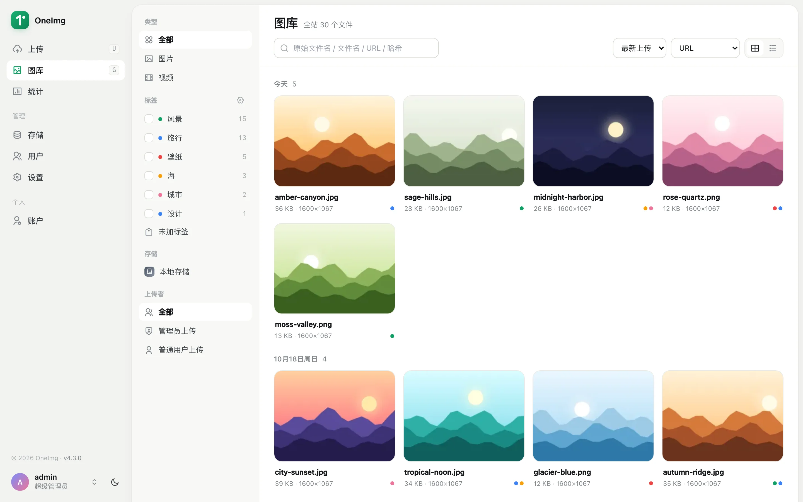
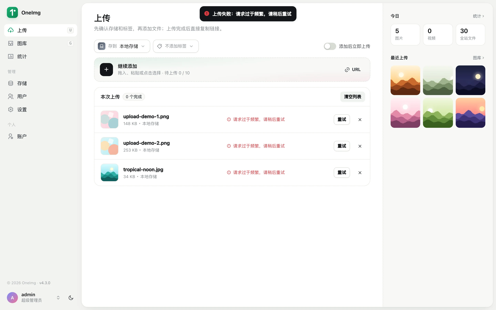
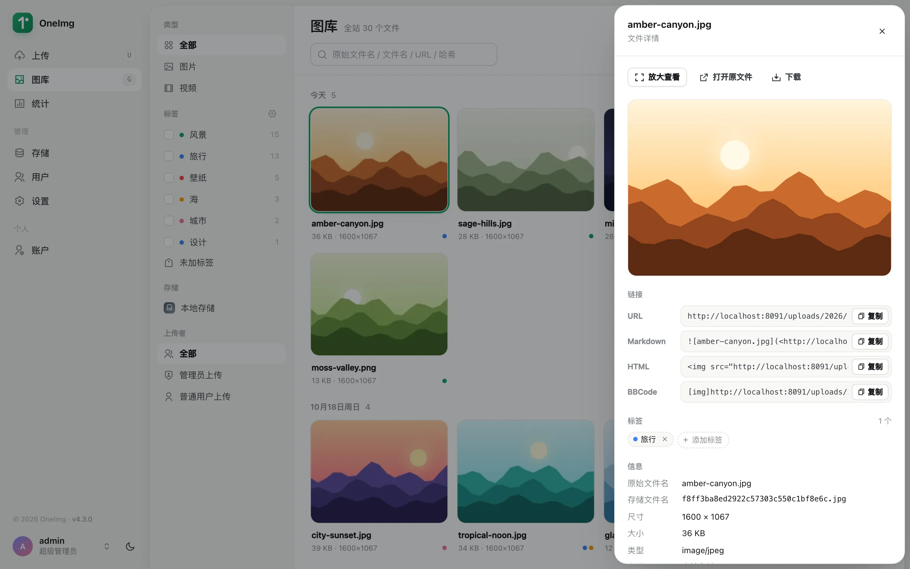
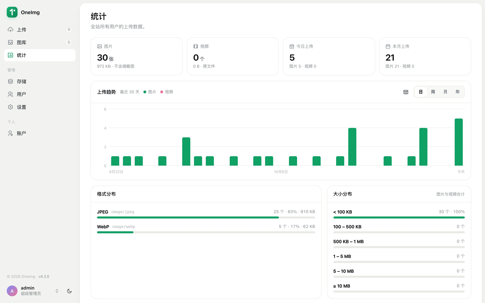
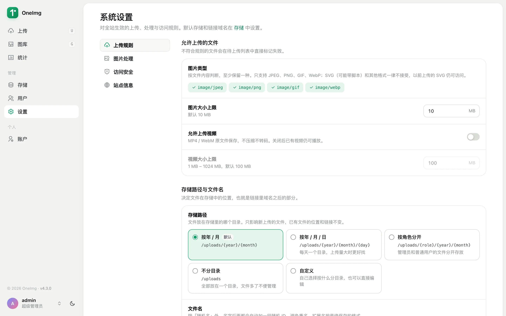
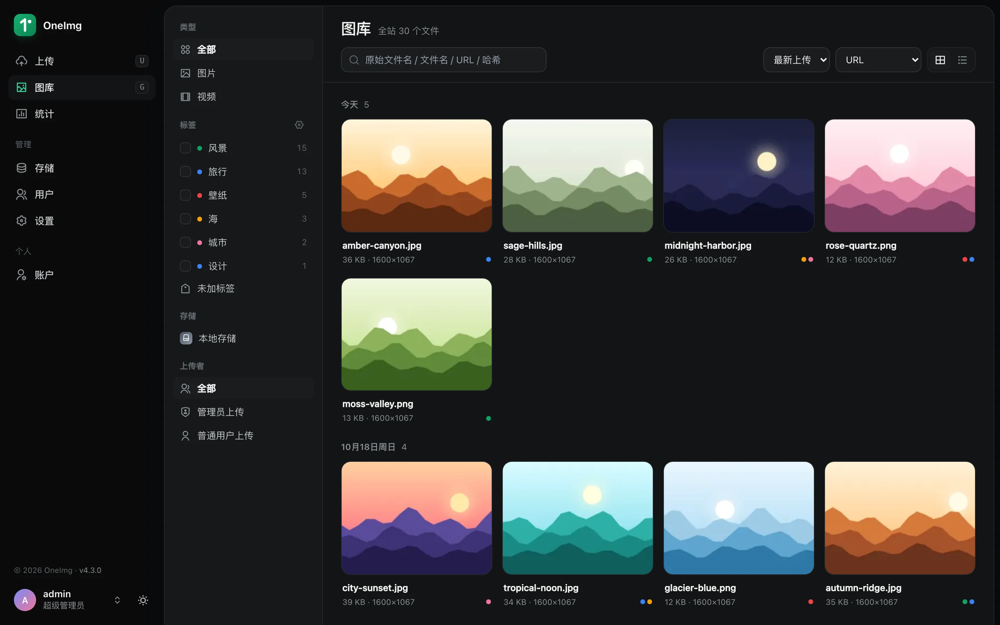
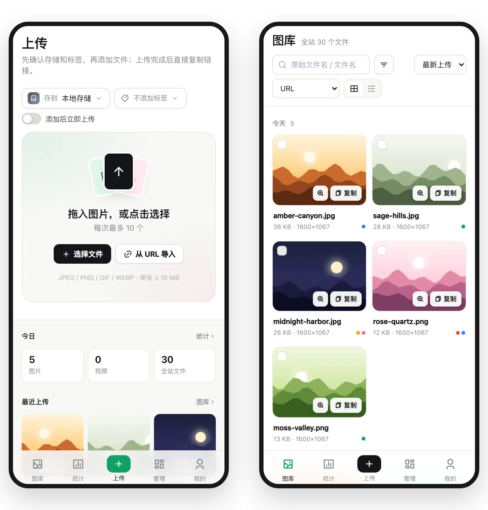

# OneImg

[](https://github.com/mikusaa/oneimg/actions/workflows/build.yaml)
[](https://github.com/mikusaa/oneimg/pkgs/container/oneimg)


OneImg 是面向个人图床和受控多账号使用的自托管媒体管理工具：上传图片后直接复制可引用的链接，再在图库里按标签、存储和日期整理。本项目是基于 [onexru/oneimg](https://github.com/onexru/oneimg) 维护的个人部署分支，使用 Go、Vue 3 和 SQLite，单个容器即可运行。



## 功能重点

- **上传快，不重复**：支持文件选择、拖拽、粘贴和图片 URL 导入，在任意页面拖入或粘贴都会进入上传队列，`U` / `G` 快捷键切换上传页和图库。按内容哈希去重，重复文件直接返回已有链接；可选 WebP 转换、压缩和缩略图。
- **复制链接顺手**：上传结果、文件详情和全屏查看器都能复制 URL、Markdown、HTML、BBCode 等格式，图库可批量复制，所选格式保存在当前浏览器。
- **图库好找**：按上传日期分组，可按类型、标签、存储和上传者筛选，按文件名、URL 或内容哈希搜索；筛选条件保存在地址中，可以收藏。统计页显示数量、体积、上传趋势和格式分布。
- **多种存储**：支持本地、S3/R2、WebDAV 和 FTP。本地存储可设置 CDN 域名，每个 S3/R2 存储可单独设置直链域名；停用存储不影响已有外链，删除存储默认保留远端文件。
- **账号与集成**：多账号与细粒度权限，密码和 Passkey 登录，带 scope 的个人访问令牌（PAT）及 API v1。
- **可选视频**：开启后可上传 MP4 / WebM 原文件并在站内播放，不转码、不依赖 FFmpeg。
- **稳妥的默认值**：新图片只接受内容确为 JPEG / PNG / GIF / WebP 的文件，拒绝 SVG 和改扩展名的伪装文件；服务器限制图像尺寸；首次启动生成随机管理员密码。这些措施用于降低常见风险，不等于完整的安全保证，部署要求见[升级指南](docs/upgrading.md)。
- **桌面与移动端**：移动端使用底部导航，支持浅色、深色和跟随系统主题。

## 界面预览

<table>
  <tr>
    <td width="50%"></td>
    <td width="50%"></td>
  </tr>
  <tr>
    <td align="center">上传：逐个或全部复制链接，重复文件返回已有链接</td>
    <td align="center">文件详情：多种链接格式、标签与文件信息</td>
  </tr>
  <tr>
    <td></td>
    <td></td>
  </tr>
  <tr>
    <td align="center">统计：上传趋势、格式与大小分布</td>
    <td align="center">系统设置：上传规则、存储路径与文件名</td>
  </tr>
  <tr>
    <td></td>
    <td></td>
  </tr>
  <tr>
    <td align="center">深色主题</td>
    <td align="center">移动端</td>
  </tr>
</table>

截图来自临时数据库，示例图片为程序生成。

## 快速启动

已安装 Docker 的新部署可直接使用固定版本镜像。以下命令在当前目录创建持久化目录，映射端口 `8080`：

```bash
mkdir -p data uploads

docker run -d \
  --name oneimg \
  --restart unless-stopped \
  -p 8080:8080 \
  -e PUID=1000 \
  -e PGID=1000 \
  -e TZ=Asia/Shanghai \
  -e APP_URL=http://localhost:8080 \
  -v "$(pwd)/data:/app/data" \
  -v "$(pwd)/uploads:/app/uploads" \
  ghcr.io/mikusaa/oneimg:v4.3.0
```

访问 `http://localhost:8080`。镜像支持 `linux/amd64` 和 `linux/arm64`；`data` 保存数据库、配置和本地缩略图，`uploads` 保存本地媒体主文件，两者都需要持久化和备份。

示例使用 `1000:1000` 作为文件属主；如需更换用户、使用 Compose、从源码构建或通过公网域名访问，请先阅读[部署指南](docs/deployment.md)。公网部署需设置实际的 `APP_URL`，配置 HTTPS 和可信代理。

## 首次登录

默认用户名为 `admin`，不再提供共享默认密码。上述新部署首次启动后，通过服务器读取随机初始密码：

```bash
docker exec oneimg cat /app/data/.initial_admin_password
```

首次登录必须修改密码，之后重新登录；即使显式设置了初始密码，也需要完成首次改密。初始密码文件权限为 `0600`，不要将其放入截图、日志或公开文档。

已有正常账号不会因升级被重置。历史默认密码账号的恢复流程见[升级指南](docs/upgrading.md#初始化与账号恢复)。

## 文档导航

| 你想做什么 | 文档 |
| --- | --- |
| 安装、配置持久化、反向代理或 Passkey | [部署指南](docs/deployment.md) |
| 上传、整理、复制外链、导入历史图片 | [使用指南](docs/usage.md) |
| 创建 PAT、调用接口、处理错误 | [API 指南](docs/api.md) |
| 备份、升级、恢复与检查兼容性变化 | [升级指南](docs/upgrading.md) |
| 本地开发、生成 SDK、测试与发布检查 | [开发指南](docs/development.md) |

## 升级与发布

升级前应备份一致的数据库、配置和媒体。v4.3.0 起本地存储的新文件统一写入 `uploads`，图片直链域名改为在存储页按存储设置，升级前请检查[存储路径](docs/upgrading.md#升级至-v430-的存储路径校验)和[直链域名](docs/upgrading.md#升级至-v430-的直链域名)。v4.2.0 起删除存储默认保留远端文件，删除或停用当前默认存储会被拒绝，见[升级指南](docs/upgrading.md#升级至-v420-的存储停用与删除)。升级至 v4.1.3 后需重新登录；改密或管理员重置会使旧会话和 PAT 失效。历史默认密码账号、可信代理、SVG 出口与缓存、图像限制及单实例运行要求，请按[升级指南](docs/upgrading.md)检查，不要直接用旧数据库撤销已完成的凭证撤销。

查看 [v4.3.0 发布说明](https://github.com/mikusaa/oneimg/releases/tag/v4.3.0)或[所有 Releases](https://github.com/mikusaa/oneimg/releases)。
